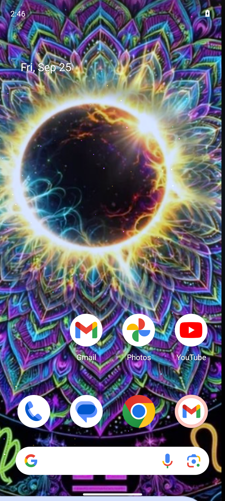

# Mandala Eclipse Live

[](https://github.com/brandonduda8/mandala-wallpaper/actions/workflows/gate.yml)
[](LICENSE)

An Android live wallpaper (`com.apexforge.mandalawallpaper`) that animates the
author's mandala eclipse art on the GPU. Plain Java and OpenGL ES, no third-party
libraries. minSdk 26, targetSdk 34.

<p align="center">
  
  <br><sub>Captured by the CI gate on an API-34 emulator.</sub>
</p>

## What it does

The scene is three parallax layers drawn by `MandalaRenderer`:

- **Far:** the mandala, aspect-filled, with a slow "breathing" zoom (±1.5% over 12 s).
- **Mid:** the eclipse core as its own sprite with stronger parallax, wrapped in
  an additive glow that pulses.
- **Near:** 120 glowing point-sprite motes drifting upward and twinkling, with
  the strongest parallax.

On top of that:

- **Time-of-day aura:** cooler tones at night, golden during the day.
- **Unlock burst:** a slow ring of light from the eclipse each time the
  wallpaper becomes visible.
- **Tap ripples**, plus **tilt parallax** from the accelerometer and
  **scroll parallax** from home-screen page offsets.
- **Music-reactive glow (best effort):** the service attaches an
  `android.media.audiofx.Visualizer` to the output mix and drives the glow from
  its energy. That needs audio-capture permission, which the manifest does not
  request yet, so on most devices (and on the emulator) the glow falls back to
  its own breathing pulse.
- **Battery discipline:** 30 fps cap, renders only while visible, no
  allocations in the draw loop, and sensors and audio capture run only while
  visible.

## Build and install

CI is the reference build: JDK 17, Android SDK 34, and Gradle 8.7 (no wrapper
is committed).

```bash
cd android
gradle assembleDebug --no-daemon
adb install app/build/outputs/apk/debug/app-debug.apk
```

Then pick **Mandala Eclipse Live** from the system's live-wallpaper picker.
Every successful CI run also uploads the debug APK as the
`mandala-eclipse-live-apk` artifact.

`build-manual.sh` is an alternative Gradle-free pipeline (aapt2 → javac → d8 →
zipalign → apksigner) the author used in a sandbox where the Gradle daemon
can't run. Its paths are hard-coded to that machine.

## Tests: the verification gate

There are no unit tests. Instead, `.github/workflows/gate.yml` runs on every
push to `main` and:

1. builds the debug APK,
2. boots an API-34 emulator and installs it,
3. sets it as the live wallpaper,
4. takes two screenshots 8 s apart and proves motion with a pixel diff
   (`.github/workflows/pixeldiff.py`),
5. fails on any crash from the package in logcat.

The screenshot above is one of those two frames.

## Assets

`assets/mandala_base.png` and `assets/eclipse_core.png` are interim crops from
a phone screenshot of the artwork. [`assets/README.md`](assets/README.md)
describes how to swap in the clean original.

## Repo layout

```
android/app/src/main/java/.../MandalaRenderer.java          GL renderer: layers, particles, aura, ripples
android/app/src/main/java/.../MandalaWallpaperService.java  wallpaper engine: visibility, sensors, touch, Visualizer
assets/                                                     source art and swap notes
gate-evidence/                                              screenshots from a passing gate run
.github/workflows/                                          gate.yml + pixeldiff.py
```

## License

Code is released under the [MIT License](LICENSE).
